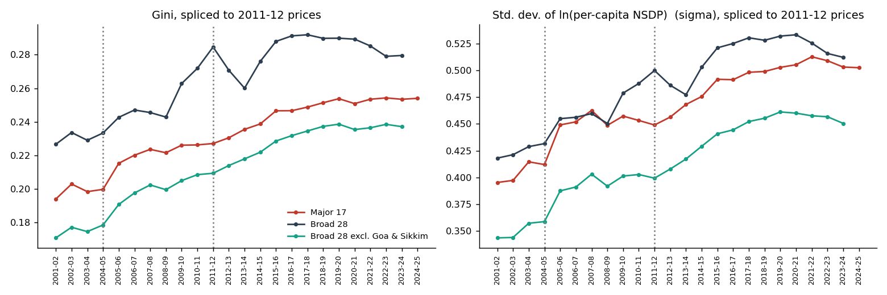
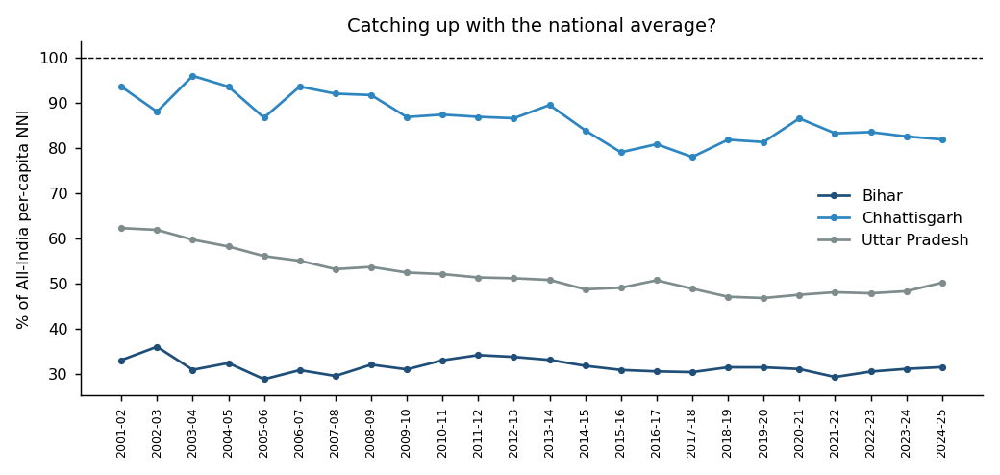

# Economic Divergence and Inequality in India

Are India's richer and poorer states moving closer together, or further apart?

I wanted to find out using real data, so I took the Reserve Bank of India's state-wise per capita income table and tracked inequality year by year from 2001-02 to 2024-25. This is a student project by Nachiket Talekar, built in Python.

## What I found

The gap is widening. Across the 17 major states, the Gini coefficient rose from 0.194 to 0.254, and every other measure of inequality I tried moved the same way.



Poorer states did not grow faster than richer ones, so there is no sign of catching up. Bihar, Jharkhand, Madhya Pradesh and Uttar Pradesh were in the bottom five at the start and are still there. Gujarat, on the other hand, grew about 7.6% a year and pulled well ahead.

Bihar is the interesting case. It grew at roughly the national median, so it kept pace, but it started so low that it still earns only about one third of the all-India average. The rupee gap between Bihar and Gujarat grew about six times.



Goa stays the richest state, but its lead over the rest has been shrinking, not growing.

The full write-up, with tables, reasoning and limitations, is in [REPORT.md](REPORT.md).

## How I did it

1. Read the official RBI workbook and turned it into one tidy table.
2. Calculated the Gini coefficient, coefficient of variation, spread of log income and a few other measures for every year.
3. Because the RBI table uses three different base years, I measured inequality inside each one first, then joined them using each state's own growth rates for a single long view.
4. Tested convergence two ways: does dispersion shrink over time, and do low-income states grow faster than high-income ones?
5. Repeated everything on different groups of states (17 major states, 28 states, with and without Goa and Sikkim) to check the result was not an accident of one choice.

## Run it yourself

You need Python with pandas, numpy, scipy and matplotlib.

```
git clone https://github.com/YOUR_USERNAME/economic-divergence-report
cd economic-divergence-report
python build_data.py
python analysis.py
```

The first script reads the RBI workbook and creates the clean CSV. The second prints the results and saves the figures. You can also open `economic_divergence_analysis.ipynb` and run it cell by cell.

## What is in this folder

```
README.md                           this page
REPORT.md                           the full analysis
economic_divergence_analysis.ipynb  the same code as a notebook
build_data.py                       reads the RBI workbook
analysis.py                         calculations and charts
data/raw/                           original RBI workbook, untouched
data/                               cleaned data and result tables
figures/                            all charts
```

## Data

Reserve Bank of India, Handbook of Statistics on Indian States, Table 10: Per Capita Net State Domestic Product, state-wise, at constant prices. The underlying source is the National Statistics Office.

## Things to keep in mind

The table has three base years, and the older ones are measured differently, so numbers from different base years should not be compared directly. Joining them is an approximation. Each state counts equally regardless of population, and per capita state output is not the same as household income. Telangana is left out because it has no data before 2011-12. The limitations section of the report explains all of this properly.
